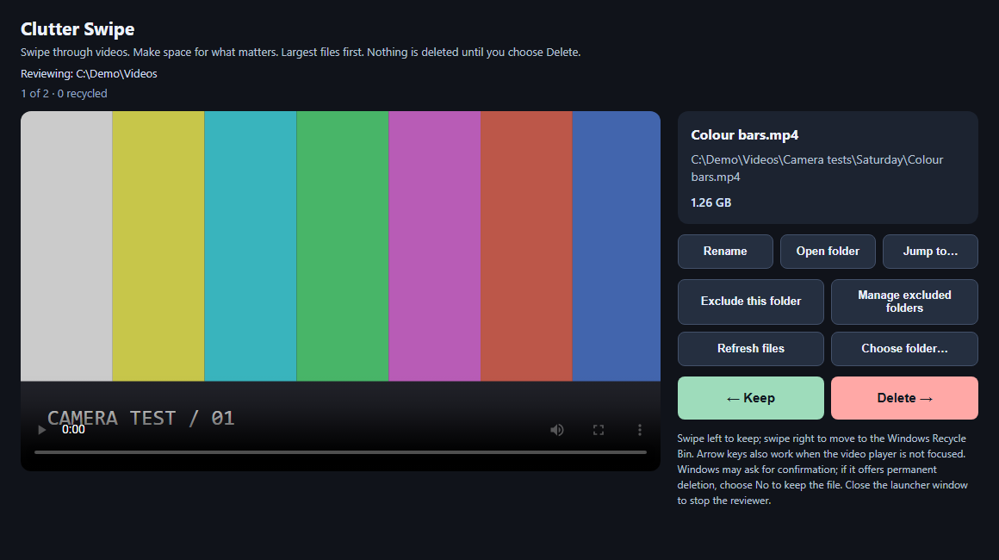
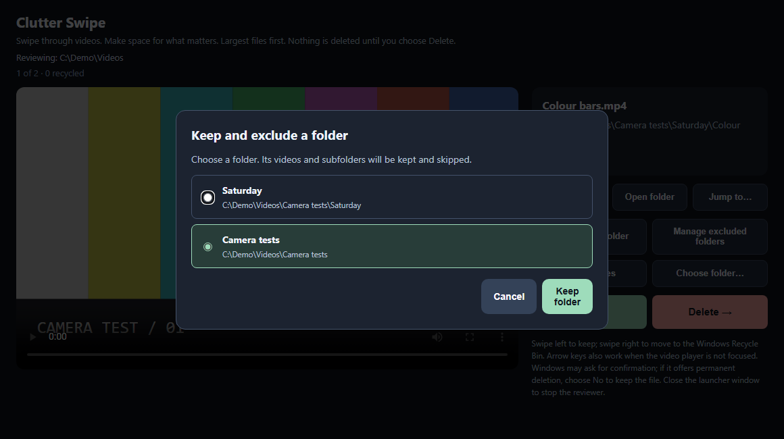

# Clutter Swipe

Think Tinder for the videos on your Windows PC. Clutter Swipe shows you one clip at a time, starting with the biggest MP4. Play it, then **swipe left to keep it** or **swipe right to send it to the Recycle Bin**. Using a mouse? Click **Keep** or **Delete**. Your videos stay on your computer.

## Open Clutter Swipe for the first time

1. **Install Python 3 for Windows** if you don’t already have it. Python runs the app. If the installer offers **Add python.exe to PATH**, tick that box so the launcher can find it. [Get Python for Windows](https://www.python.org/downloads/windows/)
2. **Download and unpack Clutter Swipe.** [Download the ZIP](https://github.com/charancreates/Clutter-swipe/archive/refs/heads/main.zip). In Downloads, right-click the ZIP, choose **Extract All**, then **Extract**.
3. **Start the app.** Open the extracted folder and double-click **Start video review.bat** (Windows may show it as **Start video review**). Leave the small launcher window open while you review. Your browser will open Clutter Swipe. If the tab doesn’t appear, copy the full address from the launcher into your browser and keep that address private.

Next time, just double-click the same launcher.

## Review your first video

1. **Check the folder.** The app starts in **Downloads** and also looks inside its subfolders. To review somewhere else, click **Choose folder…** and select it. The **Reviewing** line shows which folder you picked.
2. **Check the clip.** Click the play triangle to watch. Beside the player you’ll see the filename, where it lives, and how much space it uses. **Open folder** shows the file in File Explorer.
3. **Make your choice.** Click **← Keep** to leave the video where it is and move on. Click **Delete →** to ask Windows to move it to the Recycle Bin. If Windows offers to **permanently delete** it, choose **No** to keep the file.
4. **Stop whenever you like.** Close the launcher window to stop the app, then close the browser tab. A new session may show previously kept videos again.

**Changed your mind about a deletion?** Open the Windows **Recycle Bin**, right-click the video, and choose **Restore** to put it back in its original folder. Files in the bin still take up space until they are permanently removed.

## Keep a whole folder

If you recognize a folder full of videos you want to keep, click **Exclude this folder**. In the example below, choosing **Saturday** skips just that folder and its contents. Choosing **Camera tests** also skips every other folder inside Camera tests. Check the highlighted choice, then click **Keep folder**.

Use **Manage excluded folders** to remove a folder from the skip list. Newly added videos there can then appear. Videos already marked as kept stay marked for that session.

## Common questions

| Question | What to do |
| --- | --- |
| Why do I see “No more videos”? | Check the **Reviewing** line. Choose a folder that contains MP4 videos, or click **Refresh files** if you just added some. |
| How do I find my place in a long list? | Click **Jump to…** and enter a video number. Positions can change when files are added or removed. |
| Can I change a video’s name? | Click **Rename** and enter the new name. This changes the filename on your computer. |
| Can I use a keyboard or touchscreen? | Outside the video player, press the left arrow to keep or the right arrow to delete. On a touchscreen, swipe left to keep or right to delete. |
| Why does the launcher say Python can’t be found? | Finish the Python installation in step 1, then close and reopen the launcher. |
